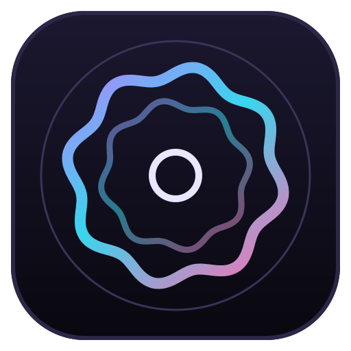

<p align="center">
  
</p>

<h1 align="center">Wobble</h1>

<p align="center">
  <strong>A CD, DVD and Blu-ray drive emulator for testing Windows optical disc software.</strong><br>
  Windows sees an ordinary optical drive. Your tests decide what is in it, and how it fails.
</p>

<p align="center">
  <a href="https://github.com/rizonesoft/Wobble/actions/workflows/ci.yml"></a>
  
  
  
  
  <a href="LICENSE"></a>
</p>

<p align="center">
  <a href="#what-works-today">What works</a> ·
  <a href="#run">Run</a> ·
  <a href="#control-api">Control API</a> ·
  <a href="#test">Test</a> ·
  <a href="#roadmap">Roadmap</a> ·
  <a href="CONTRIBUTING.md">Contributing</a>
</p>

Wobble is a userspace process that presents an emulated optical drive as an iSCSI target. Windows attaches with its built-in iSCSI initiator, so the software under test sees an ordinary optical drive and talks to it through SPTI and IMAPI2. Wobble implements the SCSI MMC command set and a disc state model. It is named after the wobble of a recordable disc's pregroove, the signal a drive follows to find its place.

Out of scope: AACS, CSS and BD+, and physical-layer fidelity beyond a simple timing and error model.

## Why it exists

- **No hardware, no blank discs.** A burn test runs in seconds on any Windows machine and wastes nothing.
- **A real drive as far as Windows can tell.** No filter driver and no kernel code: the Windows initiator and CD-ROM class driver do what they do for hardware. See [the proof](docs/proof/2026-11-15-iscsi-optical-drive.md).
- **Faults on request, the same way every time.** A write error at one address, a disc ejected mid-burn, a connection dropped during the final flush: declared as rules, with no randomness (planned, see the roadmap).
- **Every command on record.** The trace shows each CDB Windows or your software sent, with its status and sense, for assertions.

## What works today

Wobble is pre-alpha. Reading works; writing, fault injection, profiles and the control app are planned in detail and not built yet.

| Area | State |
| ---- | ----- |
| iSCSI target, Windows initiator attach over loopback | Works |
| CD-ROM and DVD-ROM from an ISO: mounts, reads, IMAPI2 lists the drive | Works |
| Raw CD model: cue sheets, 2352-byte sectors, Q subchannel, READ CD | Works in unit tests |
| CD-R and CD-RW writing (track-at-once, session-at-once, raw) | Planned |
| DVD and Blu-ray recordable media | Planned |
| Fault injection | Planned |
| Drive and media profiles, the capture tool | Planned |
| The Wobble control app | Designed ([`design/SPEC.md`](design/SPEC.md)), not built |

## Layout

| Path | What |
| --- | --- |
| `src/Wobble.Core` | MMC command set and disc state model. No transport, no sockets. |
| `src/Wobble.Iscsi` | Userspace iSCSI target. |
| `src/Wobble.Host` | `wobble`, the executable: target plus an HTTP control API. |
| `src/Wobble.Testing` | Library for Windows tests: runs the emulator, finds the drive, calls the control API. |
| `tests/Wobble.Tests` | Unit tests: byte-exact MMC responses and the iSCSI target over loopback. |
| `tests/Wobble.EndToEnd` | Windows tests through the real initiator, CDFS and IMAPI2. |
| `tools/attach.ps1` | Connects the Windows iSCSI initiator to Wobble. |
| `design/`, `assets/` | The interface specification, the icon and its renders. |
| `todo/` | The build plan, section by section. |

## Run

Requires the .NET 11 SDK.

```powershell
dotnet run --project src/Wobble.Host -- --image C:\path\disc.iso
```

Options: `--image <path>` (an ISO, or a cue sheet with its track files), `--media cd|dvd` for an ISO (default: by size), `--port 3260`, `--control-port 3261`, `--bind 127.0.0.1`, `--iqn iqn.2026-11.test.wobble:drive0`.

Then, once per boot, from an elevated PowerShell while Wobble is running:

```powershell
tools\attach.ps1
```

It starts the Microsoft iSCSI initiator service and connects to the target. The drive appears as `WOBBLE VIRTUAL DVD-ROM`. The initiator reconnects by itself when Wobble restarts, within about 15 seconds.

## Control API

HTTP JSON on `http://127.0.0.1:3261`:

- `GET /status`: target name, port and loaded media.
- `PUT /media`: `{"image": "<path>", "kind": "cd"|"dvd"|null}` inserts a disc; `{"image": null}` removes it.
- `GET /trace`: every SCSI command received, with CDB, data lengths, status and sense.
- `POST /reset`: remove the disc and clear the trace.

## Test

```powershell
pwsh scripts/check.ps1              # build, unit tests, plan validation: anywhere
pwsh scripts/check.ps1 -EndToEnd    # also the Windows tests, after tools\attach.ps1
```

The end-to-end tests start `wobble` themselves on ports 3260 and 3261, so stop any other instance first.

## Limits today

- A finalised disc only: no blank or rewritable media, and one session.
- READ CD serves header, user data, EDC and ECC and P and Q subchannel; C2 error pointers and R to W are not modelled.
- Mode pages are fixed: MODE SELECT is accepted and changes nothing.
- REPORT KEY and other copy protection commands are refused (out of scope).
- One iSCSI connection per session, no digests, no authentication; it listens on loopback only by default.
- One initiator at a time: drive state such as a pending unit attention is not kept per initiator.
- One read command transfers at most 32768 blocks (64 MiB).

## Roadmap

The live plan is [`todo/implementation-plan.md`](todo/implementation-plan.md), generated from the TODO files; the reasoning is in [the design](docs/specs/2026-11-15-wobble-design.md) and [the plan](docs/plans/2026-11-15-write-support.md).

| Phase | What it delivers |
| ----- | ---------------- |
| 0 | Shared build settings, a formatting gate, Linux in CI |
| 1 | The raw CD model finished: sessions, subchannel commands, CD-TEXT, raw reads through Windows |
| 2 | CD-R and CD-RW writing: track-at-once, session-at-once, raw; CloneCD images |
| 3 | DVD-R, DVD-RW, DVD+R and DVD+RW, burned through SPTI and IMAPI2 |
| 4 | BD-ROM, BD-R and BD-RE |
| 5 | Fault injection: rules, triggers, transport faults |
| 6 | Drive and media profiles, `wobble-capture` |
| 7 | The Wobble control app, downloads and the user guide |

## Contributing and security

How to build, test and propose a change is in [`CONTRIBUTING.md`](CONTRIBUTING.md). Report a vulnerability privately, as [`SECURITY.md`](SECURITY.md) describes.

## License

Wobble is free software under the [GNU General Public License v3.0](LICENSE). Copyright Rizonesoft.
